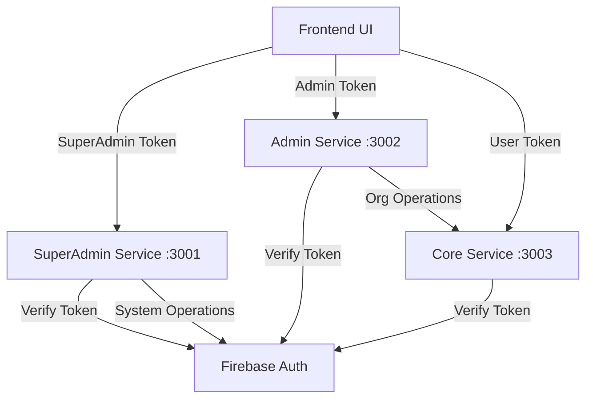

# Service-Based Architecture Migration Guide

## 🎯 **What Changed**

The monolithic frontend has been restructured into a **compartmentalized, API-based service architecture** with clear separation of concerns:

### Before (Monolithic)
```
invoice-app-v2/
├── src/services/ (all mixed together)
├── components/ (admin + user mixed)
└── pages/ (single dashboard)
```

### After (Compartmentalized) 
```
services/
├── superadmin-service/     # System-wide administration
├── admin-service/          # Organization management  
├── core-invoice-service/   # Generic invoice processing
└── shared/                 # Common utilities

invoice-app-v2/             # Pure frontend client
├── src/services/ (API clients only)
└── components/ (UI only)
```

## 🚀 **Benefits Achieved**

1. **Code Reusability**: Core service can be used standalone
2. **Independent Scaling**: Each service scales separately
3. **Clear Security Boundaries**: Role-based service access
4. **Maintainability**: Focused, single-purpose services
5. **Deployment Flexibility**: Services can run on different infrastructure

## 📋 **Migration Steps**

### 1. **Service Configuration**
Update environment variables in `invoice-app-v2/.env`:
```env
# New service URLs
VITE_SUPERADMIN_SERVICE_URL=http://localhost:3001
VITE_ADMIN_SERVICE_URL=http://localhost:3002
VITE_CORE_SERVICE_URL=http://localhost:3003

# Legacy URLs (for backward compatibility during transition)
VITE_API_URL=http://localhost:3003  # Points to core service
```

### 2. **Update Import Statements**
Replace old service imports with new API clients:

```typescript
// OLD
import { userService } from '../services/userService'
import { organizationService } from '../services/organizationService'

// NEW  
import { superAdminApiService } from '../services/superAdminApiService'
import { adminApiService } from '../services/adminApiService'
import { coreInvoiceApiService } from '../services/coreInvoiceApiService'
```

### 3. **Component Updates**
Update components to use appropriate API service:

```typescript
// SuperAdmin components use superAdminApiService
const users = await superAdminApiService.getPendingUsers()

// Admin components use adminApiService  
const orgStats = await adminApiService.getOrganizationStats()

// Core functionality uses coreInvoiceApiService
const job = await coreInvoiceApiService.uploadFiles(files)
```

## 🔄 **Backward Compatibility**

The system maintains backward compatibility during migration:

1. **Legacy API endpoints** still work through the `getApiUrl` helper
2. **Existing components** can be updated incrementally
3. **Old service files** remain until fully migrated

## 🎛️ **Running the New Architecture**

### Development (All services locally)
```bash
# Terminal 1: SuperAdmin Service
cd services/superadmin-service
npm install && npm run dev

# Terminal 2: Admin Service  
cd services/admin-service
npm install && npm run dev

# Terminal 3: Core Service
cd services/core-invoice-service  
npm install && npm run dev

# Terminal 4: Frontend
cd invoice-app-v2
npm run dev
```

### Production (Service deployment options)
- **Google Cloud Run**: Each service as separate Cloud Run service
- **Kubernetes**: Each service as separate deployment
- **Docker**: Multi-container setup
- **Serverless**: Lambda/Functions for each service

## 🔒 **Security Architecture**



## 📊 **Service Responsibilities**

| Service | Responsibilities | Port | Access |
|---------|-----------------|------|--------|
| **SuperAdmin** | User approval, system packages, analytics | 3001 | SuperAdmin only |
| **Admin** | Organization mgmt, user invites, billing | 3002 | Admin only |
| **Core** | File upload, OCR processing, results | 3003 | All users |

## 🛡️ **Migration Checklist**

- [ ] Set up service environment variables
- [ ] Install service dependencies  
- [ ] Test service health endpoints
- [ ] Update frontend API imports
- [ ] Test SuperAdmin functionality
- [ ] Test Admin functionality
- [ ] Test Core invoice processing
- [ ] Deploy services to production
- [ ] Update CI/CD pipelines
- [ ] Monitor service performance

## 🔧 **Development Tips**

1. **Service Discovery**: Use health endpoints to verify service availability
2. **API Testing**: Each service has `/api` endpoint with documentation
3. **Error Handling**: Services return consistent error formats
4. **Logging**: Each service logs independently
5. **Monitoring**: Set up separate monitoring for each service

This architecture enables true **microservices benefits** while maintaining a cohesive user experience!