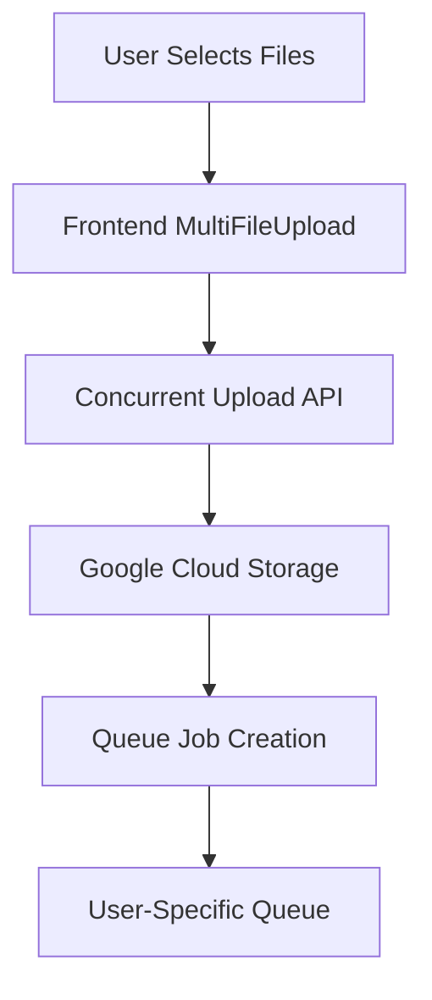

# Queue Management and Processing System - Detailed Architecture

## 🏗️ **System Overview**

The invoice processing system uses a sophisticated **multi-layered queue management architecture** designed to handle up to 100 concurrent file uploads while ensuring fair processing, rate limiting, and reliable error handling.

## 📋 **Core Components**

### 1. **QueueProcessor Class**
```python
class QueueProcessor:
    def __init__(self):
        self.processing_users = set()           # Track active user processing
        self.last_api_call = {}                # Rate limiting per user
        self.openai_processing_lock = threading.Lock()  # Serial OpenAI processing
        self.global_queue_size = 0             # Total queued jobs
        self.max_global_queue_size = 100       # System-wide limit
        self.current_processing_job = None      # Track current OpenAI job
```

### 2. **Data Structures**

#### **JobStatus Dataclass**
```python
@dataclass
class JobStatus:
    job_id: str
    user_email: str
    status: str              # pending, processing, completed, failed
    created_at: datetime
    updated_at: datetime
    retry_count: int = 0
    error_message: Optional[str] = None
    result: Optional[Dict] = None
    progress: float = 0.0    # 0.0 to 1.0
```

#### **Error Classification**
```python
class ErrorType(Enum):
    PARAMETER_ERROR = "parameter_error"  # Abort immediately
    NETWORK_ERROR = "network_error"     # Retry with backoff
    UNKNOWN_ERROR = "unknown_error"     # Default retry
```

## 🔄 **Queue Processing Flow**

### **Phase 1: File Upload & Queue Entry**

1. **Frontend Multi-Upload**: User selects up to 100 files
2. **Concurrent Upload**: Files uploaded to initial-api (5 concurrent by default)
3. **Storage**: Files stored in Google Cloud Storage bucket
4. **Queue Addition**: Each file creates a job entry via `/add-job` endpoint



### **Phase 2: Queue Management**

#### **Global Queue Capacity Control**
```python
def check_global_queue_capacity(self) -> bool:
    """Enforce system-wide queue limit"""
    if self.global_queue_size >= self.max_global_queue_size:
        return False  # Reject new jobs
    return True
```

#### **User Queue Structure (Firestore)**
```
/user_queues/{user_email}/jobs/{job_id}
├── job_id: string
├── user_email: string
├── bucket_path: string
├── status: "pending" | "processing" | "completed" | "failed"
├── created_at: timestamp
├── retry_count: number
├── progress: float (0.0-1.0)
└── next_retry_at: timestamp (optional)
```

### **Phase 3: Serial Processing Engine**

#### **Key Design Principle: ONE OpenAI Request at a Time**
```python
def process_single_job(self, job_data: Dict) -> bool:
    with self.openai_processing_lock:  # CRITICAL: Serial processing
        # Only ONE job can call OpenAI API at any time
        self.current_processing_job = job_data['id']
        result = self._call_openai_vision_api(...)
        self.current_processing_job = None
```

### **Phase 4: File Processing Pipeline**

#### **PDF Processing Workflow**
```python
def _process_pdf_file(self, file_content: bytes, bucket_path: str, job_id: str):
    # 1. Convert PDF to images (max 3 pages for cost control)
    pdf_pages = pdf_processor.convert_pdf_to_images(file_content, max_pages=3)
    
    # 2. Process each page with OpenAI (serial processing)
    for page_result in pdf_pages:
        page_analysis = self._call_openai_vision_api(
            page_result.base64_image, 
            page_result.image_format,
            f"{job_id}_page_{page_result.page_number}"
        )
    
    # 3. Combine results from all pages
    # 4. Return structured invoice data
```

#### **Image Processing Workflow**
```python
def _process_image_file(self, file_content: bytes, blob_path: str, job_id: str):
    # 1. Convert to base64 for OpenAI Vision API
    # 2. Determine image format (jpeg, png, gif, webp)
    # 3. Single OpenAI API call
    # 4. Return structured invoice data
```

## 🎯 **Processing Strategy**

### **1. User-Level FIFO Queues**
```python
def get_next_job_for_user(self, user_email: str) -> Optional[Dict]:
    # Query user's queue for pending jobs, ordered by creation time (FIFO)
    query = jobs_ref.where('status', '==', 'pending').order_by('created_at').limit(1)
```

### **2. Rate Limiting**
```python
def check_rate_limit(self, user_email: str) -> bool:
    # 1000 requests per minute = 1 request per 0.06 seconds
    min_interval = 60.0 / RATE_LIMIT_PER_MINUTE
    if now - last_call >= min_interval:
        return True  # Allow request
```

### **3. Error Handling & Retry Logic**

#### **Exponential Backoff**
```python
def calculate_backoff_delay(self, retry_count: int) -> float:
    return min(2 ** retry_count, 60)  # Max 60 seconds
```

#### **Smart Error Classification**
- **Parameter Errors**: Abort immediately (invalid file format, malformed data)
- **Network Errors**: Retry with backoff (rate limits, timeouts, 429/503 errors)
- **Unknown Errors**: Default to retry strategy

#### **Retry Process**
1. **Attempt 1**: Immediate processing
2. **Attempt 2**: 2-second delay
3. **Attempt 3**: 4-second delay
4. **Attempt 4**: 8-second delay
5. **Attempt 5**: 16-second delay
6. **Final**: Mark as failed, remove from queue

## 📊 **Data Flow & Results**

### **OpenAI Vision API Integration**
```python
def _call_openai_vision_api(self, base64_image: str, image_format: str, job_id: str):
    # Enhanced prompt for structured invoice data extraction
    messages = [{
        "role": "user",
        "content": [
            {"type": "text", "text": ENHANCED_INVOICE_PROMPT},
            {"type": "image_url", "image_url": {"url": f"data:image/{image_format};base64,{base64_image}"}}
        ]
    }]
    
    response = openai.chat.completions.create(
        model="gpt-4o-mini",
        messages=messages,
        max_tokens=4000,
        temperature=0.1
    )
```

### **Result Processing & Storage**

#### **Data Restructuring**
```python
def restructure_response_data(self, extracted_data: Dict) -> Dict:
    # 1. Extract InvoiceDetails and SuggestedJournalEntries
    # 2. Eliminate duplication between line items and summary entries
    # 3. Create unified structure for consistent frontend display
```

#### **Tabulated Data Generation**
```python
def create_tabulated_data_from_invoice_details(self, invoice_data: Dict) -> Dict:
    # Create 8-column table structure:
    headers = [
        "Invoice", "Description", "Amount", 
        "Debit Account", "Credit Account", "Narration",
        "Seller", "Buyer"
    ]
    # Populate rows from line items with journal entries
```

#### **Firestore Storage Strategy**
```python
# Complex nested data stored as JSON strings to avoid Firestore limitations
firestore_safe_result = {
    "tabulated_data_json": json.dumps(tabulated_data),
    "extracted_data_json": json.dumps(result),
    "has_tabulated_data": tabulated_data.get('success', False)
}
```

## 🚦 **Queue Status Monitoring**

### **Real-Time Queue Metrics**
```python
def get_queue_status(self) -> Dict:
    return {
        "global_queue_status": {
            "current_size": self.global_queue_size,
            "max_capacity": self.max_global_queue_size,
            "utilization_percentage": (self.global_queue_size / self.max_global_queue_size) * 100
        },
        "processing_status": {
            "active_users": len(self.processing_users),
            "current_job": self.current_processing_job
        }
    }
```

### **Background Processing Loop**
```python
def continuous_queue_processing():
    # Background thread that continuously:
    # 1. Scans for pending jobs across all users
    # 2. Processes user queues in fair rotation
    # 3. Handles retries for failed jobs
    # 4. Manages global queue capacity
```

## ⚡ **Performance Characteristics**

### **Throughput Metrics**
- **File Upload**: 5 concurrent uploads (configurable up to 20)
- **Queue Capacity**: 100 jobs system-wide
- **Processing Rate**: 1 OpenAI request at a time (serial processing)
- **Average Processing Time**: 14-15 seconds per invoice
- **Retry Attempts**: Up to 5 attempts with exponential backoff

### **Scalability Design**
- **Horizontal Scaling**: Multiple Cloud Run instances share the same Firestore queue
- **Load Distribution**: Fair processing across users with FIFO guarantees
- **Cost Optimization**: Serial OpenAI processing prevents API quota exhaustion
- **Fault Tolerance**: Individual file failures don't affect other uploads

## 🎯 **Key Benefits**

### **1. Fairness**
- FIFO processing within each user's queue
- Fair rotation between users
- No user can monopolize the system

### **2. Reliability**
- Comprehensive error handling and retry logic
- Persistent queue storage in Firestore
- Graceful handling of Cloud Run restarts

### **3. Cost Control**
- Serial OpenAI processing prevents quota overruns
- PDF page limits (3 pages max)
- Intelligent retry strategies

### **4. Performance**
- Concurrent file uploads
- Efficient queue management
- Real-time progress tracking

### **5. Monitoring**
- Detailed logging for all operations
- Queue status metrics
- Processing time analytics

This architecture successfully handles the user's requirement for **"multiple uploads up to 100 files"** while maintaining system stability, cost control, and fair processing guarantees.