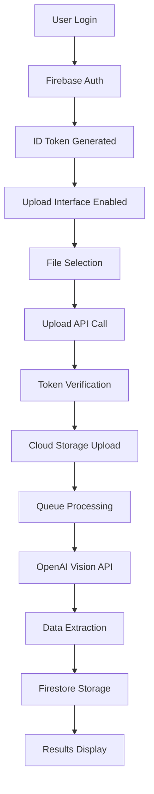

# System Architecture Trace
## Complete Flow Documentation for User Authentication and Image Processing

### 🔐 USER AUTHENTICATION FLOW

#### 1. User Login Journey
```
Frontend (React/TypeScript) → Firebase Auth → Backend Services
```

**Step 1: User Interface Interaction**
- Component: `App.tsx` (lines 45-83)
- User clicks "Sign in with Google" button
- Authentication gate: Prevents access to upload interface if not authenticated

**Step 2: Firebase Authentication Service**
- Service: `authService.ts` (lines 26-67)
- Method: `signInWithPopup(auth, GoogleAuthProvider)`
- Scopes requested: `email`, `profile` 
- Custom parameters: `prompt: 'select_account'`
- **Result**: Firebase user object with `uid`, `email`, `displayName`

**Step 3: User State Management**
- Hook: `useAuth.ts` (lines 30-78)
- `onAuthStateChanged()` listener monitors login state
- Extends Firebase user to app-compatible format:
  ```typescript
  {
    ...firebaseUser,
    id: firebaseUser.uid,
    name: firebaseUser.displayName || firebaseUser.email,
    email: firebaseUser.email
  }
  ```
- Provides dual compatibility: `isAuthenticated` and `isSignedIn`

**Step 4: Token Generation for API Calls**
- Service: `multiUploadApi.ts` (lines 30-45)
- Method: `auth.currentUser.getIdToken()`
- **Critical**: Firebase ID token used for all backend authentication
- Headers: `Authorization: Bearer {idToken}`

**Step 5: Backend Token Verification**
- Service: `initial-api/Cloudrun_version/main.py` (lines 45-62)
- Method: `firebase_auth.verify_id_token(id_token_str)`
- Validates token signature and extracts user email
- **Security**: All API endpoints require valid Firebase token

### 📸 IMAGE PROCESSING PIPELINE

#### 1. File Upload Flow
```
File Selection → Upload Interface → Signed URL → Storage → Processing Queue → OpenAI Analysis → Results
```

**Step 1: File Selection & Validation**
- Component: `FileUpload.tsx` (lines 20-45)
- Accepts: Images (JPG, PNG, GIF, WebP) and PDF documents
- Features: Drag-and-drop, file browser, multi-file support
- Validation: File type checking, size display

**Step 2: Upload Trigger**
- User clicks "Upload & Process" button
- Component calls `onUpload()` callback to parent
- Authentication check: Ensures user is logged in before proceeding

**Step 3: Authentication & API Call**
- Service: `multiUploadApi.ts` (lines 50-110)
- Gets Firebase ID token: `auth.currentUser.getIdToken()`
- Creates FormData with file
- POST to: `/.netlify/functions/upload-invoice`
- Headers: `Authorization: Bearer {firebase-token}`

**Step 4: Backend Upload Processing**
- Service: `initial-api/Cloudrun_version/main.py` (lines 65-120)
- Verifies Firebase token and extracts user email
- Generates unique file path: `raw/{timestamp}_{filename}`
- **Storage**: Uploads to Google Cloud Storage bucket
- **Job ID**: Generated from timestamp for tracking

#### 2. Queue Processing & Analysis

**Step 5: Queue Processing Service**
- Service: `queue-processor/main.py` (lines 1-50)
- Components: QueueManager, OpenAIProcessor, ResultManager
- Background processing: Continuous monitoring for new files

**Step 6: Image Analysis with OpenAI**
- Service: `queue-processor/openai_processor.py` (lines 1-50)
- **Vision API**: Processes images using OpenAI GPT-4 Vision
- **PDF Support**: Converts PDF to images using pdf2image
- **Prompt**: Specialized for Indian purchase invoice extraction

**Processing Flow:**
```python
def process_file(file_path):
    1. Download from Google Cloud Storage
    2. Convert PDF to images (if PDF)
    3. Encode image as base64
    4. Send to OpenAI Vision API with invoice prompt
    5. Parse JSON response for invoice data
    6. Store results in Firestore
    7. Update job status
```

**Step 7: Data Extraction**
- **Specialized Prompt**: Designed for Indian purchase invoices
- **Output Format**: Structured JSON with:
  - vendor_name, invoice_number, invoice_date
  - total_amount, tax_amount, line_items
  - gstin_vendor, place_of_supply
- **Storage**: Results saved to Firestore with job ID

### 🔄 COMPLETE DATA FLOW



### 🏗️ SYSTEM COMPONENTS

#### Frontend (React/TypeScript)
- **Authentication**: Firebase SDK v10.14.1
- **Upload Interface**: FileUpload component with drag-drop
- **API Service**: Authenticated requests with Firebase tokens
- **State Management**: useAuth hook for auth state

#### Backend Services (Python/Flask)
- **initial-api**: File upload endpoint with Firebase auth verification
- **queue-processor**: Background processing with OpenAI integration
- **Storage**: Google Cloud Storage for file management
- **Database**: Firestore for results and job tracking

#### Infrastructure (Google Cloud Platform)
- **Project**: watch-mail-trial (812016027146)
- **Region**: asia-south1
- **Authentication**: Firebase Auth with Google OAuth
- **Processing**: Cloud Run services for scalability
- **AI**: OpenAI GPT-4 Vision API for invoice analysis

### 🔒 SECURITY MODEL

1. **Authentication**: Firebase ID tokens for all API calls
2. **Authorization**: User email extraction from verified tokens
3. **CORS**: Configured for invoiceparse.netlify.app domain
4. **File Access**: Signed URLs for secure file upload/download
5. **API Keys**: Environment variables for OpenAI integration

### 📊 MONITORING & TRACKING

- **Job IDs**: Timestamp-based tracking for each upload
- **Status Updates**: Real-time processing status in Firestore
- **Error Handling**: Comprehensive logging and user feedback
- **Authentication Logs**: User login/logout tracking

This system provides a complete, secure, and scalable solution for invoice processing with Firebase authentication and OpenAI-powered data extraction.