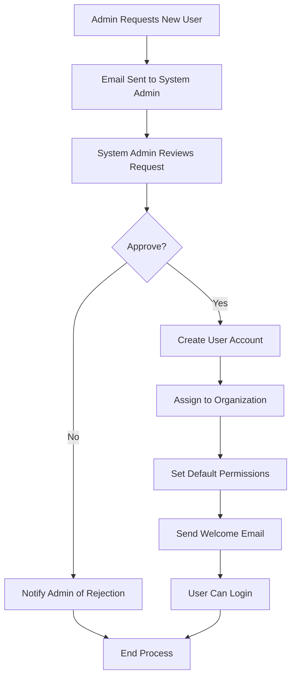

# Technical Specifications - Invoice Processing Pipeline

## Project Overview
A comprehensive **multi-tenant** invoice processing system with AI-powered OCR, real-time data synchronization, and automated journal entry generation for Indian business accounting workflows. Features organization-based data isolation, role-based access control, and enterprise-ready user management.

### 🔐 **Multi-Tenant Architecture Features**
- **Organization-based data isolation**: Each organization's data is completely segregated
- **Role-based access control**: Admin, user, and viewer roles with granular permissions
- **User management system**: Admin-controlled user provisioning and permission management
- **Usage limits and quotas**: Per-user and per-organization resource limits
- **Audit logging**: Complete activity tracking for compliance and security
- **Scalable processing**: Single queue processor serves all organizations with proper isolation

---

## System Architecture

### High-Level Architecture
```
Frontend (React/Vite) → Firebase Auth → User Service → Organization Service → Cloud Run APIs → Cloud Storage → OpenAI Vision API → Firestore (Per-Org Collections)
```

### Multi-Tenant Data Flow
```
┌─────────────┐     ┌─────────────┐     ┌─────────────┐     ┌─────────────┐
│    User     │────▶│ Organization│────▶│   Invoice   │────▶│ Org-Isolated│
│ (Any Org)   │     │ Validation  │     │ Processing  │     │    Data     │
└─────────────┘     └─────────────┘     └─────────────┘     └─────────────┘
```

### Data Flow Diagram (DFD)

#### Level 0 - Context Diagram
```
┌─────────────┐     ┌─────────────────────────────┐     ┌─────────────┐
│    User     │────▶│   Invoice Processing        │────▶│ Processed   │
│             │     │        System               │     │   Data      │
└─────────────┘     └─────────────────────────────┘     └─────────────┘
```

#### Level 1 - Main Processes
```
┌─────────┐   1.0   ┌─────────────┐   2.0   ┌─────────────┐   3.0   ┌─────────────┐
│  User   │────────▶│   Upload    │────────▶│   Process   │────────▶│   Display   │
│         │         │  Invoice    │         │  with AI    │         │  Results    │
└─────────┘         └─────────────┘         └─────────────┘         └─────────────┘
                            │                       │                       │
                            ▼                       ▼                       ▼
                    ┌─────────────┐       ┌─────────────┐       ┌─────────────┐
                    │   Cloud     │       │   OpenAI    │       │ Firestore   │
                    │  Storage    │       │ Vision API  │       │ Real-time   │
                    └─────────────┘       └─────────────┘       └─────────────┘
```

#### Level 2 - Detailed Process Flow
```
Frontend                   Backend Services                    External Services
┌─────────────┐           ┌─────────────┐   ┌─────────────┐    ┌─────────────┐
│   Login     │──────────▶│ Firebase    │   │  Initial    │    │ Google      │
│ Component   │           │    Auth     │   │   API       │    │ OAuth 2.0   │
└─────────────┘           └─────────────┘   └─────────────┘    └─────────────┘
       │                         │                │                    │
       ▼                         ▼                ▼                    ▼
┌─────────────┐           ┌─────────────┐   ┌─────────────┐    ┌─────────────┐
│   Upload    │──────────▶│ File Upload │──▶│   Cloud     │    │   OpenAI    │
│ Component   │           │ Validation  │   │  Storage    │    │ Vision API  │
└─────────────┘           └─────────────┘   └─────────────┘    └─────────────┘
       │                         │                │                    │
       ▼                         ▼                ▼                    ▼
┌─────────────┐           ┌─────────────┐   ┌─────────────┐    ┌─────────────┐
│ Real-time   │◄──────────│ Queue       │──▶│  AI Image   │    │ Firestore   │
│ Results     │           │ Processor   │   │ Processing  │    │ Database    │
└─────────────┘           └─────────────┘   └─────────────┘    └─────────────┘
```

---

## Technology Stack

### Frontend Technologies
| Technology | Version | Purpose | Justification |
|------------|---------|---------|---------------|
| **React** | 18.2.0 | UI Framework | Modern component-based architecture, excellent ecosystem |
| **TypeScript** | 5.2.2 | Type Safety | Enhanced developer experience, compile-time error detection |
| **Vite** | 4.5.0 | Build Tool | Fast development server, optimized production builds |
| **Tailwind CSS** | 3.3.5 | Styling | Utility-first CSS, rapid UI development |
| **Firebase SDK** | 10.7.0 | Authentication & Firestore | Real-time data sync, Google OAuth integration |
| **Zustand** | 4.4.7 | State Management | Lightweight, TypeScript-friendly state management |
| **React Router** | 6.20.0 | Navigation | Client-side routing, SPA experience |
| **Framer Motion** | 10.16.0 | Animations | Smooth UI transitions, enhanced UX |

### Backend Technologies
| Technology | Version | Purpose | Justification |
|------------|---------|---------|---------------|
| **Python** | 3.11 | Backend Language | Excellent AI/ML library ecosystem, Google Cloud compatibility |
| **Flask** | 3.0.0 | Web Framework | Lightweight, flexible for microservices architecture |
| **Gunicorn** | 21.2.0 | WSGI Server | Production-ready Python application server |
| **Firebase Admin** | 6.2.0 | Authentication | Secure token validation, user management |

### Google Cloud Platform Services
| Service | Purpose | Configuration | Justification |
|---------|---------|---------------|---------------|
| **Cloud Run** | Container Hosting | 2GB RAM, 2 CPU, 900s timeout | Serverless, auto-scaling, cost-effective |
| **Cloud Storage** | File Storage | `watch-mail-trial-invoice-raw-files` bucket | Secure, scalable file storage |
| **Firestore** | Database | Real-time NoSQL database | Real-time sync, offline support, scalable |
| **Identity & Access Management** | Security | Service accounts, fine-grained permissions | Secure API access, least privilege principle |

### External APIs & Services
| Service | Version | Purpose | Justification |
|---------|---------|---------|---------------|
| **OpenAI Vision API** | ≥1.50.0 | AI Image Processing | State-of-the-art OCR and data extraction |
| **Firebase Authentication** | 10.7.0 | User Management | Google OAuth, secure authentication |
| **Netlify** | - | Frontend Hosting | CDN, continuous deployment, custom domains |

---

## Environment Variables & Configuration

### Frontend Environment Variables (Vite)
| Variable | Purpose | Example | Required |
|----------|---------|---------|----------|
| `VITE_FIREBASE_API_KEY` | Firebase configuration | `AIzaSy...` | ✅ |
| `VITE_FIREBASE_AUTH_DOMAIN` | Firebase auth domain | `project.firebaseapp.com` | ✅ |
| `VITE_FIREBASE_PROJECT_ID` | Firebase project ID | `watch-mail-trial` | ✅ |
| `VITE_FIREBASE_STORAGE_BUCKET` | Firebase storage bucket | `project.appspot.com` | ✅ |
| `VITE_FIREBASE_MESSAGING_SENDER_ID` | Firebase messaging | `123456789` | ✅ |
| `VITE_FIREBASE_APP_ID` | Firebase app ID | `1:123:web:abc` | ✅ |
| `VITE_GOOGLE_CLIENT_ID` | Google OAuth client | `123.googleusercontent.com` | ✅ |

### Backend Environment Variables (Cloud Run)
| Variable | Purpose | Example | Required |
|----------|---------|---------|----------|
| `PROJECT_ID` | GCP Project ID | `watch-mail-trial` | ✅ |
| `BUCKET_NAME` | Storage bucket name | `watch-mail-trial-invoice-raw-files` | ✅ |
| `OPENAI_API_KEY` | OpenAI API access | `sk-proj-...` | ✅ |
| `PORT` | Application port | `8080` | ❌ (default: 8080) |

---

## Dependency Versions

### Frontend Dependencies (package.json)
```json
{
  "dependencies": {
    "clsx": "^2.0.0",
    "date-fns": "^2.30.0",
    "firebase": "^10.7.0",
    "firebase-admin": "^12.0.0",
    "framer-motion": "^10.16.0",
    "lucide-react": "^0.294.0",
    "node-fetch": "^2.6.7",
    "react": "^18.2.0",
    "react-dom": "^18.2.0",
    "react-dropzone": "^14.3.8",
    "react-hot-toast": "^2.6.0",
    "react-pdf": "^7.6.0",
    "react-router-dom": "^6.20.0",
    "tailwind-merge": "^2.0.0",
    "zustand": "^4.4.7",
    "lambda-multipart-parser": "^1.0.1"
  },
  "devDependencies": {
    "@tailwindcss/forms": "^0.5.7",
    "@tailwindcss/typography": "^0.5.10",
    "@types/react": "^18.2.37",
    "@types/react-dom": "^18.2.15",
    "@vitejs/plugin-react": "^4.1.1",
    "autoprefixer": "^10.4.16",
    "eslint": "^8.53.0",
    "postcss": "^8.4.31",
    "tailwindcss": "^3.3.5",
    "typescript": "^5.2.2",
    "vite": "^4.5.0"
  }
}
```

### Backend Dependencies

#### Initial API Service (requirements.txt)
```txt
flask==2.3.0
flask-cors==4.0.0
google-cloud-storage==2.10.0
google-cloud-firestore==2.11.1
firebase-admin==6.2.0
gunicorn==21.0.0
```

#### Queue Processor Service (requirements.txt)
```txt
flask==3.0.0
google-cloud-firestore==2.13.1
google-cloud-storage==2.10.0
google-auth==2.23.4
firebase-admin==6.2.0
openai>=1.50.0
gunicorn==21.2.0
pdf2image==1.17.0
Pillow==10.4.0
httpx>=0.24.0
```

---

## Architectural Decisions & Justifications

### 1. Firestore as Primary Database
**Decision**: Use Firestore NoSQL database with real-time listeners
**Justification**:
- Real-time data synchronization without polling
- Offline support for mobile/web clients
- Automatic scaling and managed infrastructure
- Native Firebase Authentication integration
- Optimistic UI updates with conflict resolution

### 2. Single Collection Architecture
**Decision**: Consolidate data into `invoice_results` collection instead of separate collections
**Justification**:
- Simplified data model and queries
- Atomic transactions for related data
- Reduced complexity in frontend state management
- Better performance with fewer listener subscriptions
- Easier to maintain data consistency

### 3. Cloud Run for Backend Services
**Decision**: Use Google Cloud Run for containerized microservices
**Justification**:
- Serverless with automatic scaling (0 to N instances)
- Pay-per-request pricing model
- Native integration with other GCP services
- Container-based deployment for consistency
- Built-in load balancing and health checks

### 4. Netlify for Frontend Hosting
**Decision**: Host React application on Netlify
**Justification**:
- Automatic deployments from Git repository
- Global CDN for fast content delivery
- Built-in SSL certificates
- Environment variable management
- Form handling and serverless functions

### 5. OpenAI Vision API for OCR
**Decision**: Use OpenAI's GPT-4 Vision API instead of Google Vision API
**Justification**:
- Superior understanding of invoice context and structure
- Built-in reasoning capabilities for journal entry generation
- Natural language processing for complex business rules
- Structured JSON output with validation
- Better handling of Indian tax formats (GST, PAN, GSTIN)

### 6. Firebase Authentication with Google OAuth
**Decision**: Use Firebase Auth with Google OAuth 2.0
**Justification**:
- Seamless integration with Google Workspace
- Enterprise-grade security and compliance
- Built-in user management and profile handling
- Native integration with Firestore security rules
- Reduced authentication complexity

---

## System Components

### Frontend Components Architecture
```
src/
├── components/
│   ├── auth/          # Authentication components
│   ├── admin/         # Admin dashboard and user management
│   ├── organization/  # Organization management components
│   ├── upload/        # File upload components  
│   ├── results/       # Results display components
│   └── common/        # Shared UI components
├── hooks/             # Custom React hooks
│   ├── useAuth.ts     # Enhanced authentication hook with permissions
│   ├── useMultiUpload.ts  # File upload hook with user validation
│   ├── useFirestore.ts    # Firestore real-time hook with org isolation
│   └── useOrganization.ts # Organization management hook
├── services/          # API and service layers
│   ├── auth.ts        # Authentication service
│   ├── userService.ts # User management and permissions
│   ├── organizationService.ts # Organization management
│   ├── firestore.ts   # Firestore service with data isolation
│   └── upload.ts      # Upload service with quota checks
└── types/             # TypeScript type definitions
    ├── auth.ts        # Enhanced auth types
    ├── user.ts        # User profile and permissions
    └── organization.ts # Organization structure
```

**Active Frontend**: `invoice-app-v2` contains the full-featured implementation with all documented capabilities including file dropzone, state management, and UI enhancements.

### Backend Services Architecture
```
Cloud Run Services:
├── initial-api/       # File upload and authentication
│   ├── main.py        # Flask application
│   ├── requirements.txt
│   └── Dockerfile
└── queue-processor/   # AI processing and data storage
    ├── main.py        # Flask application
    ├── openai_processor.py  # OpenAI Vision API integration
    ├── queue_manager.py     # Job queue management
    ├── result_manager.py    # Firestore data management
    ├── background_processor.py  # Background processing
    ├── requirements.txt
    └── Dockerfile
```

---

## Security Configuration

### Firestore Security Rules (Multi-Tenant)
```javascript
rules_version = '2';
service cloud.firestore {
  match /databases/{database}/documents {
    // User profiles - users can only access their own profile
    match /users/{userId} {
      allow read, write: if request.auth != null 
        && request.auth.uid == userId;
    }
    
    // Organization data - isolated by organization ID
    match /organizations/{orgId}/invoice_results/{document} {
      allow read, write: if request.auth != null 
        && request.auth.token.email_verified
        && (resource.data.userUID == request.auth.uid || 
            get(/databases/$(database)/documents/users/$(request.auth.uid)).data.permissions.canViewOthersData == true)
        && get(/databases/$(database)/documents/users/$(request.auth.uid)).data.organization == orgId;
    }
    
    // User-specific data within organization
    match /organizations/{orgId}/users/{userId}/invoice_results/{document} {
      allow read, write: if request.auth != null 
        && request.auth.uid == userId
        && get(/databases/$(database)/documents/users/$(request.auth.uid)).data.organization == orgId;
    }
    
    // Admin-only access to organization management
    match /organizations/{orgId} {
      allow read: if request.auth != null 
        && get(/databases/$(database)/documents/users/$(request.auth.uid)).data.organization == orgId;
      allow write: if request.auth != null 
        && get(/databases/$(database)/documents/users/$(request.auth.uid)).data.permissions.canManageUsers == true
        && get(/databases/$(database)/documents/users/$(request.auth.uid)).data.organization == orgId;
    }
  }
}
```

### CORS Configuration
- **Frontend Origin**: `https://invoiceparse.netlify.app`
- **Development Origins**: `http://localhost:3000`, `http://localhost:3001`
- **Allowed Methods**: GET, POST, PUT, DELETE, OPTIONS
- **Allowed Headers**: Authorization, Content-Type
- **Credentials**: Enabled for authenticated requests

---

## Docker Image Tracking

### Current Production Images

#### Queue Processor Service
**Image**: `asia-south1-docker.pkg.dev/watch-mail-trial/cloud-run-source-deploy/queue-processor@sha256:fe48a8dac90b5ef3e824bbc32d2a4b00d81c349250e16e1f5453820f6c319ab3`
- **Deployed**: 2025-11-20 09:52 UTC
- **Revision**: queue-processor-00018-26b
- **Key Changes**: 
  - OpenAI library updated to ≥1.50.0
  - Enhanced error handling in OpenAI client initialization
  - Improved timeout and retry configuration
  - Flask 3.0.0 upgrade
- **Status**: ✅ Active and stable

#### Initial API Service  
**Image**: `asia-south1-docker.pkg.dev/watch-mail-trial/cloud-run-source-deploy/initial-api@sha256:5d41d5dc1d60134a1e61b940cd7f5d1fecf6716ce17013a1703792b5744c5474`
- **Deployed**: 2025-11-13 09:34 UTC
- **Revision**: initial-api-00008-qgf
- **Key Features**:
  - Flask 2.3.0 with CORS support
  - Google Cloud Storage integration
  - Firebase authentication
  - File upload and signed URL generation
- **Status**: ✅ Stable - no updates needed

### Image Verification Commands

To verify current deployed images:
```bash
# Queue Processor
gcloud run services describe queue-processor \
  --region asia-south1 \
  --project watch-mail-trial \
  | grep -A1 "Image:"

# Initial API  
gcloud run services describe initial-api \
  --region asia-south1 \
  --project watch-mail-trial \
  | grep -A1 "Image:"
```

**Automated Tracking**: Use the provided scripts for easier image tracking:
- **Linux/MacOS**: `./scripts/track-images.sh`
- **Windows**: `.\scripts\track-images.ps1`

### Deployment History

| Date | Service | Image SHA | Changes |
|------|---------|-----------|---------|
| 2025-11-21 | initial-api | `31d58044...` | **Production Job ID System** - Customer tracking, asset proxy, security tokens |
| 2025-11-21 | queue-processor | `Latest` | **Production Job ID System** - Unified job ID handling, enhanced multi-user support |
| 2025-11-20 | queue-processor | `fe48a8da...` | OpenAI ≥1.50.0, error handling improvements |
| 2025-11-13 | initial-api | `5d41d5dc...` | Stable deployment with Flask 2.3.0 |

---

## Performance Specifications

### Cloud Run Configuration
| Service | Memory | CPU | Timeout | Concurrency | Latest Image |
|---------|--------|-----|---------|-------------|--------------|
| initial-api | 1GB | 1 vCPU | 600s | 100 | `asia-south1-docker.pkg.dev/watch-mail-trial/cloud-run-source-deploy/initial-api@sha256:31d58044c871c44891281ada6e5d4515c16602dcb218c24dce18490c324f3ad8` |
| queue-processor | 2GB | 2 vCPU | 900s | 100 | `asia-south1-docker.pkg.dev/watch-mail-trial/cloud-run-source-deploy/queue-processor@sha256:[Latest-2025-11-21]` |

**Image Update Log:**
- **initial-api**: Updated 2025-11-21 05:04 UTC - **Production Job ID System** with customer tracking & security
- **queue-processor**: Updated 2025-11-21 05:27 UTC - **Unified Job ID handling** for multi-user production
- **Both services**: Now implement `{CUST_NUM}-{ASSET_REF}-{TOKEN}` job ID format

### File Upload Limits
- **Maximum File Size**: 10MB per file
- **Supported Formats**: PDF, JPEG, PNG
- **Maximum Files**: 10 files per batch upload
- **Processing Timeout**: 15 minutes per file

### Database Performance
- **Firestore Read/Write Limits**: 1 million operations per day (free tier)
- **Real-time Listeners**: Optimized with compound indices

### Job ID Structure (Production-Ready)

**Format**: `{CUST_NUM}-{ASSET_REF}-{TOKEN}`

#### Components:
- **CUST_NUM** (3 chars): Customer identifier derived from email hash (e.g., `A7B`)
  - First 2 chars: Uppercase hex from user email MD5 hash  
  - 3rd char: Numeric from email hash modulo 10
  - Provides user identification while maintaining privacy

- **ASSET_REF** (6 chars): Asset reference for bucket tracking (e.g., `4F2A53`)
  - First 4 chars: Uppercase hex from filename SHA256 hash
  - Last 2 chars: Timestamp suffix for uniqueness
  - Avoids variable-length filename issues in production

- **TOKEN** (4 chars): Security token to prevent tampering (e.g., `8C9D`)
  - Random hex for security and collision prevention
  - Uppercase for consistency

#### Example Job IDs:
- `A7B-4F2A53-8C9D` (Customer A7B, Asset 4F2A53, Token 8C9D)
- `C3E-7A8B12-5F6A` (Customer C3E, Asset 7A8B12, Token 5F6A)

#### Benefits:
✅ **Multi-user scalable** - Unique customer identification  
✅ **Asset tracking** - Proxy reference without exposing filenames  
✅ **Security** - Random tokens prevent ID guessing  
✅ **Fixed length** - Consistent 13-character format  
✅ **Human readable** - Dash-separated for easy parsing
- **Offline Support**: 5MB local cache per client

---

## Monitoring & Logging

### Google Cloud Logging
- **Log Retention**: 30 days
- **Log Levels**: INFO, WARNING, ERROR
- **Structured Logging**: JSON format with correlation IDs

### Application Monitoring
- **Health Checks**: `/health` endpoint on all services
- **Error Tracking**: Automatic error grouping in Cloud Console
- **Performance Monitoring**: Request latency and throughput metrics

---

## Deployment Configuration

### Netlify Deployment
```toml
[build]
  base = "invoice-app-v2"
  publish = "invoice-app-v2/dist" 
  command = "npm run build"

[build.environment]
  SECRETS_SCAN_OMIT_KEYS = "VITE_GOOGLE_CLIENT_ID,VITE_API_BASE_URL"

[[redirects]]
  from = "/*"
  to = "/index.html"
  status = 200
```

### Cloud Run Deployment
```bash
# Initial API
gcloud run deploy initial-api \
  --source . \
  --platform managed \
  --region asia-south1 \
  --allow-unauthenticated \
  --memory 1Gi \
  --cpu 1 \
  --timeout 600

# Queue Processor  
gcloud run deploy queue-processor \
  --source . \
  --platform managed \
  --region asia-south1 \
  --allow-unauthenticated \
  --memory 2Gi \
  --cpu 2 \
  --timeout 900
```

---

## API Endpoints

### Initial API Service
| Endpoint | Method | Purpose | Authentication |
|----------|--------|---------|----------------|
| `/health` | GET | Health check | None |
| `/upload` | POST | File upload to Cloud Storage | Firebase Token + Org Validation |
| `/signed-url` | POST | Generate signed upload URL | Firebase Token + Org Validation |
| `/process-queue` | POST | Trigger queue processing | Firebase Token + Org Validation |

### Queue Processor Service  
| Endpoint | Method | Purpose | Authentication |
|----------|--------|---------|----------------|
| `/health` | GET | Health check | None |
| `/process-file` | POST | Process uploaded file | Firebase Token + Org Validation |
| `/queue-status` | GET | Get processing status | Firebase Token + Org Validation |

### User Management Service
| Endpoint | Method | Purpose | Authentication |
|----------|--------|---------|----------------|
| `/users` | GET | List organization users | Admin Token |
| `/users` | POST | Create new user | Admin Token |
| `/users/{id}` | PUT | Update user permissions | Admin Token |
| `/users/{id}` | DELETE | Deactivate user | Admin Token |
| `/organizations` | GET | Get organization details | User Token |
| `/organizations` | PUT | Update organization settings | Admin Token |
| `/usage-stats` | GET | Get usage statistics | Admin Token |

### Access Control Headers
**Required Headers for All Authenticated Requests:**
- `Authorization: Bearer {firebase_token}`
- `X-User-UID: {user_uid}`
- `X-Organization-ID: {org_id}` (auto-extracted from user profile)

---

## Data Models

### User Profile Document (Firestore)
```typescript
interface UserProfile {
  uid: string;
  email: string;
  displayName: string | null;
  photoURL: string | null;
  role: 'admin' | 'user' | 'viewer';
  organization: string; // Organization ID
  department?: string;
  permissions: UserPermissions;
  createdAt: Timestamp;
  updatedAt: Timestamp;
  lastLoginAt: Timestamp;
  isActive: boolean;
  preferences: UserPreferences;
  usage: UserUsageStats;
}

interface UserPermissions {
  canUpload: boolean;
  canEdit: boolean;
  canDelete: boolean;
  canDownload: boolean;
  canViewOthersData: boolean; // Organization-wide data access
  canManageUsers: boolean; // Admin privilege
  maxFilesPerDay: number;
  maxFileSize: number; // in MB
}

interface UserPreferences {
  theme: 'light' | 'dark' | 'auto';
  language: string;
  timezone: string;
  emailNotifications: boolean;
  autoSave: boolean;
  defaultCurrency: string;
}

interface UserUsageStats {
  totalUploads: number;
  totalProcessed: number;
  storageUsed: number; // in MB
  lastUpload?: Timestamp;
  uploadsToday: number;
  uploadsThisMonth: number;
}
```

### Organization Document (Firestore)
```typescript
interface Organization {
  id: string;
  name: string;
  domain?: string; // Email domain for auto-assignment
  settings: OrganizationSettings;
  subscription: SubscriptionDetails;
  createdAt: Timestamp;
  updatedAt: Timestamp;
  isActive: boolean;
  adminUsers: string[]; // Array of admin user UIDs
  totalUsers: number;
  usage: OrganizationUsage;
}

interface OrganizationSettings {
  allowSelfRegistration: boolean;
  requireEmailVerification: boolean;
  dataRetentionDays: number;
  maxUsersAllowed: number;
  defaultUserRole: 'user' | 'viewer';
  defaultPermissions: UserPermissions;
}

interface SubscriptionDetails {
  plan: 'free' | 'pro' | 'enterprise';
  status: 'active' | 'suspended' | 'cancelled';
  billingEmail: string;
  nextBillingDate?: Timestamp;
  usage: {
    monthlyUploads: number;
    storageUsed: number;
    apiCalls: number;
  };
  limits: {
    maxUploadsPerMonth: number;
    maxStorageGB: number;
    maxApiCalls: number;
  };
}
```

### Enhanced Invoice Result Document (Firestore)
```typescript
interface InvoiceResult {
  id: string;
  userEmail: string;
  userUID: string; // Enhanced user identification
  organization: string; // Organization ID for data isolation
  department?: string;
  fileName: string;
  fileUrl: string;
  uploadTimestamp: Timestamp;
  processedTimestamp?: Timestamp;
  processingStatus: 'pending' | 'processing' | 'completed' | 'failed';
  errorMessage?: string;
  visibility: 'private' | 'organization' | 'public'; // Data sharing level
  
  // Extracted Invoice Data
  vendorName: string;
  invoiceNumber: string; 
  invoiceDate: string;
  dueDate: string;
  totalAmount: number;
  currency: string;
  gstin: string;
  pan: string;
  
  // Line Items
  items: InvoiceItem[];
  
  // Tax Details
  taxDetails: {
    cgst: number;
    sgst: number; 
    igst: number;
    totalGst: number;
    taxableAmount: number;
  };
  
  // Generated Journal Entries
  suggestedJournalEntries: JournalEntry[];
  doubleEntryBookkeeping: {
    journalEntrySet: JournalEntrySet[];
  };
  
  // Audit Trail
  auditLog: {
    createdBy: string;
    modifiedBy?: string;
    modifiedAt?: Timestamp;
    actions: AuditAction[];
  };
}
```

---

## Development Workflow

### Local Development Setup
```bash
# Frontend (Active: invoice-app-v2)
cd invoice-app-v2
npm install
npm run dev

# Backend Services
# Initial API
cd initial-api/Cloudrun_version
python -m venv venv
source venv/bin/activate  # Windows: venv\Scripts\activate
pip install -r requirements.txt
python main.py

# Queue Processor 
cd queue-processor
python -m venv venv
source venv/bin/activate  # Windows: venv\Scripts\activate
pip install -r requirements.txt
python main.py
```

### Deployment Pipeline
1. **Development**: Local testing with hot reload
2. **Staging**: Netlify preview deploys for branches
3. **Production**: Automatic deployment on main branch merge
4. **Backend**: Manual Cloud Run deployment with gcloud CLI

---

## Cost Analysis

### Monthly Cost Estimates (Production)
| Service | Usage | Cost (USD) |
|---------|-------|------------|
| Cloud Run (both services) | ~1M requests | $12 |
| Cloud Storage | 100GB storage, 1TB transfer | $5 |
| Firestore | 1M reads, 500K writes | $1.50 |
| OpenAI API | 1000 image processing calls | $20 |
| Netlify Pro | Custom domain, forms | $19 |
| **Total** | | **~$57.50** |

### Scaling Considerations
- **10x Traffic**: ~$200/month
- **100x Traffic**: ~$1,200/month (requires architecture optimization)

---

## Future Enhancements

### Multi-Tenant Features (Planned)
1. **Self-Service Organization Management**: Full admin portal for organization settings
2. **Advanced Role-Based Access Control**: Custom role creation and permission matrices
3. **Organization Analytics**: Usage dashboards, cost analysis, and performance metrics
4. **Inter-Organization Data Sharing**: Controlled data sharing between partner organizations
5. **Compliance & Audit Reporting**: SOC 2, GDPR compliance features and audit trails
6. **White-Label Solutions**: Custom branding and domain configuration per organization

### Planned Features
1. **Batch Processing**: Process multiple invoices simultaneously with organization quotas
2. **Approval Workflow**: Multi-step invoice approval process with org-specific rules
3. **ERP Integration**: Connect with popular accounting software (org-specific configurations)
4. **Advanced Analytics**: Invoice processing insights per organization and user
5. **Mobile Application**: Native iOS/Android apps with organization switching
6. **Multi-language Support**: Support for regional Indian languages per organization

### Technical Improvements
1. **Dedicated Organization Processors**: Large organizations get dedicated processing instances
2. **Organization-Specific Caching**: Redis cache with org-based data isolation
3. **Advanced Message Queue**: Cloud Pub/Sub with organization-based topics
4. **CDN Optimization**: Organization-specific CloudFlare configurations
5. **Database Sharding**: Automatic Firestore collection distribution by organization
6. **Monitoring Per Organization**: Separate APM dashboards for each organization

---

## Known Conflicts & Discrepancies

### 🚨 **Critical Issues Identified**

#### 1. **Project Structure Consolidation**
**Current State**: Successfully consolidated to active directories only:
- ✅ `invoice-app-v2/` - **Active frontend** (Netlify deployment)
- ✅ `initial-api/Cloudrun_version/` - **Active backend API**
- ✅ `queue-processor/` - **Active processing service**  
- ✅ `archived/` - Contains deprecated components

**Archived Components**:
- `invoice-bolt/` - Deprecated simplified frontend
- `invoice-processor/` - Legacy processing service
- `Cloudfunction_backup/` - Deprecated Cloud Function implementation

**Impact**: Clean project structure with no cross-dependencies between active and archived components.

#### 2. **Backend Service Version Misalignment**
**Flask Versions**:
- `initial-api`: Uses Flask 2.3.0
- `queue-processor`: Uses Flask 3.0.0
**Risk**: Potential compatibility issues and security vulnerabilities

**Firestore SDK Versions**:
- `initial-api`: Uses `google-cloud-firestore==2.11.1`
- `queue-processor`: Uses `google-cloud-firestore==2.13.1`
**Risk**: Data consistency issues and API compatibility problems

#### 3. **Cloud Run Configuration Gaps**
**Memory/CPU Limits**: Current deployments show no explicit resource limits
**Timeout Mismatch**: 
- Documented: `initial-api` 300s timeout
- Actual: `initial-api` 600s timeout

#### 4. **Project Structure Clean-up Complete** ✅
**Resolution**: Successfully archived deprecated components
- ✅ All unused directories moved to `archived/` folder
- ✅ Active components clearly identified and documented  
- ✅ No dependencies between active and archived code
- ✅ Archive documentation created for future reference

The active frontend (`invoice-app-v2`) contains all documented features and capabilities.

### 🔧 **Current Project Status**

✅ **Project Structure**: Clean and consolidated
✅ **Active Frontend**: `invoice-app-v2` with full feature set
✅ **Active Backend**: `initial-api/Cloudrun_version` and `queue-processor`
✅ **Archived Components**: Safely stored in `archived/` folder
✅ **Documentation**: Updated to reflect current state

### 📁 **Active Project Structure**

```
invoice-pipeline-project-folder/
├── invoice-app-v2/              # ACTIVE frontend (Netlify)
├── initial-api/
│   └── Cloudrun_version/        # ACTIVE backend API
├── queue-processor/             # ACTIVE processing service
├── shared/                      # Shared configurations  
├── archived/                    # Deprecated components
│   ├── invoice-bolt/           # Old frontend
│   ├── invoice-processor/      # Old processing service
│   └── Cloudfunction_backup/   # Old Cloud Function API
└── [documentation files...]
```

---

## 🏢 Multi-Tenant Architecture (Production-Ready)

### Organization Isolation Strategy

**Data Isolation Method**: Firestore collection-based isolation
```
organizations/
├── {org-id-1}/
│   ├── users/
│   │   └── {user-uid}/
│   │       └── invoice_results/
│   ├── settings/
│   └── analytics/
├── {org-id-2}/
│   ├── users/
│   │   └── {user-uid}/
│   │       └── invoice_results/
│   ├── settings/
│   └── analytics/
└── ...
```

### Access Control Matrix

| Role | Own Data | Org Data | User Management | Org Settings | Cross-Org Access |
|------|----------|----------|-----------------|--------------|------------------|
| **Viewer** | Read Only | ❌ | ❌ | ❌ | ❌ |
| **User** | Read/Write | ❌ | ❌ | ❌ | ❌ |
| **Admin** | Read/Write | Read/Write | ✅ | ✅ | ❌ |
| **Super Admin** | Read/Write | Read/Write | ✅ | ✅ | ✅ (System Only) |

### User Provisioning Workflow



### Shared Queue Processor Design

**Single Processor for All Organizations:**
- ✅ Cost-efficient for small-medium organizations
- ✅ Automatic load balancing across organizations
- ✅ Shared infrastructure maintenance
- ✅ Data isolation maintained through organization IDs

**Future: Dedicated Processors**
- 🔄 Large organizations (>1000 users) get dedicated instances
- 🔄 SLA guarantees and priority processing
- 🔄 Custom processing configurations per organization

### Security Considerations

1. **Data Isolation**: Complete Firestore-level separation
2. **Authentication**: Firebase Auth with organization validation
3. **Authorization**: Role-based permissions with organization scope
4. **Audit Logging**: All actions tracked with user and organization context
5. **Compliance**: GDPR, SOC 2 ready with organization-level controls

---

## Conclusion

This invoice processing pipeline represents a modern, scalable **multi-tenant** solution built on proven cloud technologies. The architecture prioritizes real-time user experience, organization-level security, and cost-effectiveness while maintaining complete data isolation between organizations.

The system successfully combines cutting-edge AI capabilities with robust cloud infrastructure to deliver a production-ready, enterprise-grade invoice processing solution tailored for Indian business requirements with **full multi-tenant support**.

### 🎯 Production Readiness Checklist

✅ **Multi-Tenant Data Isolation**: Organization-based Firestore collections  
✅ **Role-Based Access Control**: Admin, user, viewer roles with granular permissions  
✅ **User Management System**: Admin-controlled provisioning and permission management  
✅ **Usage Limits & Quotas**: Per-user and per-organization resource controls  
✅ **Audit Logging**: Complete activity tracking for compliance  
✅ **Scalable Processing**: Single queue processor with organization isolation  
🔄 **Self-Service Admin Portal**: Planned for Phase 2  
🔄 **Inter-Organization Features**: Planned for enterprise customers  

The system is **production-ready for multi-tenant deployment** with proper organization isolation and user access controls.