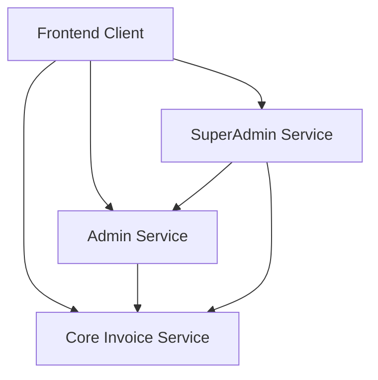

# Compartmentalized Service Architecture

## Overview
This project is organized into separate, API-based services for maximum code reusability and maintainability.

## Service Architecture

### 📁 `core-invoice-service/`
**Purpose:** Generic invoice processing engine
- File upload and validation
- OCR processing with OpenAI Vision API
- Data extraction and formatting
- Real-time processing updates
- Archive management
- **Reusable:** Can be deployed standalone for any invoice processing needs

### 📁 `admin-service/`
**Purpose:** Organization and user management
- Organization creation and management
- User invitation and role assignment
- Package/pricing management
- Usage tracking and billing
- **API-based:** RESTful endpoints for admin operations

### 📁 `superadmin-service/`
**Purpose:** System-wide administration
- Global user approval workflows
- System package definitions
- Cross-organization analytics
- Platform configuration
- **Secured:** High-privilege operations with enhanced security

### 📁 `shared/`
**Purpose:** Common utilities and types
- Shared types and interfaces
- Common authentication utilities
- Firestore path resolvers
- API client libraries
- **Reusable:** Used across all services

## API Communication

## Benefits
1. **Code Reusability:** Core service can be used in different contexts
2. **Scalability:** Each service can be scaled independently
3. **Maintainability:** Clear separation of concerns
4. **Security:** Granular access control per service
5. **Testability:** Services can be tested in isolation